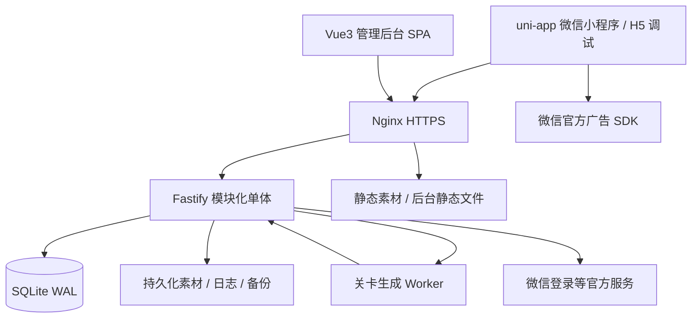

# 格有趣（GridFun）｜技术架构与数据库设计基线

- 版本：1.0.1｜2026-11-24
- 状态：架构方案已确认；具体实现、依赖兼容及性能尚待验证
- 关联：[产品需求](01-product-requirements.md) · [开发计划](03-development-plan.md)

## 1. 架构目标及决策

普通微信小程序为已确认的客户端开发目标（不是 Canvas 小游戏）。使用自有 ECS、自有数据库，不使用微信云开发。采用单仓库、前后端分离、模块化单体；不预先引入 Redis、MQ、微服务、Kubernetes、Elasticsearch、WebSocket、独立对象存储。普通小程序游戏类目准入是上线前置验证，若不满足须重新确认平台路线，不能用技术形式规避审核。

| 层 | 技术 |
|---|---|
| 客户端 | uni-app + Vue3 + TypeScript，Pinia，SCSS/CSS，自研轻量组件，View/Flex，Grid 兼容验证，Vite |
| 平台 | mp-weixin，H5 调试，微信开发者工具及真机；uni.request、uni.login、uni Storage，微信原生广告 API |
| 管理后台 | Vue3/TS、Element Plus、UnoCSS、Vue Router、Pinia、Axios、ECharts、Vite |
| 后端 | Node.js 26.10.0、Fastify 5、TypeScript、Pino、JSON Schema/TypeBox、OpenAPI |
| 数据 | SQLite WAL、Drizzle ORM、better-sqlite3 |
| 认证 | 微信登录换取服务端身份、JWT + 服务端会话，管理员 Argon2id |
| 任务 | Worker Threads、数据库持久化任务队列、Node 定时任务 |
| 工程 | Monorepo、Yarn Workspaces、统一 lockfile、ESLint、Prettier、严格 TS、Vitest |
| 部署 | Docker Compose、Nginx、HTTPS、Git 私有仓库 |

具体依赖小版本和 Yarn 主版本在工程初始化时验证兼容性后锁定；本文件不声称这些依赖已安装或运行通过。



## 2. 仓库与模块边界

```text
grid-fun/
├── apps/
│   ├── game/src/
│   │   ├── pages/         # 16 个页面模块
│   │   ├── components/    # GameBoard, GridCell, Toolbar, Dialog 等
│   │   ├── composables/
│   │   ├── stores/
│   │   ├── services/
│   │   ├── platform/      # 微信 / H5 平台适配
│   │   ├── styles/
│   │   ├── static/
│   │   ├── App.vue
│   │   ├── main.ts
│   │   ├── pages.json
│   │   └── manifest.json
│   ├── admin/src/
│   │   ├── views/ components/ layouts/ router/ stores/ api/
│   └── server/src/
│       ├── modules/ routes/ middleware/ database/ workers/ jobs/
│       └── main.ts
├── packages/
│   ├── core/              # 纯 TypeScript，算法与规则
│   ├── shared/            # 类型、契约、枚举、常量
│   └── assets/            # 默认素材及配置
├── deploy/
│   ├── nginx/ docker/ scripts/
│   └── docker-compose.yml
├── tests/
├── docs/
├── .env.example
├── package.json
├── yarn.lock
└── README.md
```

Core 下划分 `board`、`rules`、`generator`、`solver`、`validator`、`difficulty`、`evaluation`、`game`、`hint`。独立无 UI、网络或数据库依赖。客户端只打包实时规则和操作需要的子模块；不下发正式答案，不打包批量生成器。Admin 复用核心规则做试玩（Web Vue 实现，不复制业务算法），Server 使用生成、验证、提示、评价模块。Shared 为纯类型和跨端协议，不依赖业务应用。Assets 区分内置与后台发布资源。

后端业务模块：auth、users、levels、level-tasks、chapters、daily、games、assets、rewards、signins、themes、ads、analytics、configs、announcements、feedback、admin、audit、backups。模块内分接口、服务、持久化职责；跨业务事务由服务层组织，禁止客户端越权修改状态。

## 3. 核心算法及质量控制

1. 生成合法目标布局：行列唯一且八邻接禁止（可用排列搜索）。
2. 从每个目标位置扩展对应区域，保证全棋盘覆盖、每区域一个目标、四邻接连通。
3. 使用剪枝回溯搜索解数，发现第二解即淘汰；独立检查四规则与区域结构。
4. 模拟人类逻辑推理，按技巧级别、步数和复杂度计算难度；唯一解不等于容易推理，无法达到质量标准则拒绝。难度阈值及具体技巧集合需开发验证、试玩校准。
5. 归一化区域 ID，考虑四旋转及镜像等价布局，生成稳定哈希；数据库唯一约束避免并发重复。
6. 绑定生成任务的星级规则模板快照、规则版本、生成器版本、评分和校验报告。
7. 合格关卡进入待发布库；管理员预览、试玩、发布，发布前再次校验。正式发布数据不可变。

任务独立计算，默认一个 Worker；数据库保存任务状态、配置、进度、候选/合格数、失败原因、耗时。支持取消、暂停、重试、服务重启后安全恢复或显式失败重试。设置搜索次数、时长、内存预算；高负载暂停新任务。Worker 不长时间持有数据库写事务。批量不足如实报告，不降低质量要求。支持离线生成 JSON 导入后重新校验。

星级引擎采用处理器注册表 `completion` / `duration` / `errorCount`，规则输入和版本明确；不同附加条件独立计星，历史版本处理器保留。未识别规则不得静默当作通过。后续扩展类型须实现处理器、指标、校验、客户端展示与测试，不是仅后台加字符串。

## 4. 客户端运行及渲染

- 普通 View 组件按行列循环渲染 N² 格子，Flex 布局；动态边框依据相邻区域 ID 计算，颜色与边界均可识别。安全区、状态栏、触摸坐标映射及滑动性能真机验证。
- 基础格状态独立于自动排除、冲突和提示派生状态。单次手势形成撤销单元；撤销不回退累计错误；重置新尝试指标，历史最高不变。
- 使用 Pinia 管理账号、配置、资产、主题、当前会话及设置。模式独立存档。游戏页面卸载、进入后台、暂停、广告时处理生命周期和计时；计时使用累计活跃时长，不依赖 UI 是否显示。
- 本地实时存档，间隔同步，退出尽力同步，结算立即提交；本地持久化用于网络中断恢复，不直接覆盖服务端资产。离线体验关卡与正式结算分离；服务端提示不可用时不扣权益。
- 平台适配封装登录、网络、存储、音频、震动、广告、生命周期；H5 使用明确测试适配，不能在生产模拟广告发奖。
- 静态默认主题随包，其他主题按需下载缓存；素材失败回退默认。主题设计 Token 使用动态样式，不影响规则。
- 微信用户无需手机号/头像昵称授权；仅最小身份信息。初始化流程：缓存→认证→服务器 bootstrap→存档同步→首页/教学。

## 5. 数据库选型与持久化

SQLite 适用于当前单节点初期负载，WAL 允许读写更好并行但仍单写入者。禁止把数据库放到不满足 WAL 要求的共享网络文件系统；数据库、WAL 文件位于持久化卷。每个连接应用必要 PRAGMA：

```sql
PRAGMA journal_mode = WAL;
PRAGMA synchronous = FULL;
PRAGMA foreign_keys = ON;
PRAGMA busy_timeout = 5000;
```

关键结算事务短小、唯一约束防重复、索引支持分页与统计；长查询与大批写入分批执行。监控锁等待、WAL 大小、磁盘及接口延迟。数据库升级使用迁移脚本，备份后执行并验证。未来如需 PostgreSQL/MySQL，须迁移 schema、查询、数据及测试，并非只改连接字符串。

### 5.1 逻辑表规划（41 张候选表）

以下为已讨论的业务边界及建议关键字段，不是已经执行的 DDL。详细设计可合理合并/拆分，保留业务约束。所有时间由服务端统一处理；业务日以 Asia/Shanghai 为准。

| 表 | 关键字段 / 用途 |
|---|---|
| users | id, wechat_openid 唯一, player_code 唯一, nickname, status, created_at, last_active_at |
| user_sessions | id, user_id, expires_at, revoked_at |
| user_settings | user_id 唯一, settings_json, version |
| admin_users | id, username 唯一, password_hash, status |
| admin_sessions | id, admin_id, expiry, revocation |
| levels | id, size, regions_json, solution_json, difficulty, difficulty_score, hash 唯一, star_rules_json, rule_version, generator_version, validation_json, status, published_at, locked |
| level_templates | id, name, config_json, version |
| level_generation_tasks | id, config_snapshot, status, progress, candidate_count, accepted_count, error, timestamps |
| chapters | id, name, cover, recommended_theme, sort, status |
| chapter_levels | id, chapter_id, level_id, sequence 唯一, published_at |
| daily_challenges | id, date 唯一, level_id, reward_config, status |
| game_sessions | id, user_id, mode, level_id, context_id, rule_version, reward_version, state, started_at |
| game_saves | session_id 唯一, board_json, metrics_json, history_json, version, updated_at |
| game_records | id, session_id, user_id, result, duration, error_count, stars, metrics_json, timestamps |
| user_level_progress | user_id + classic_entry_id 唯一, best_stars, best_duration, completed_at |
| user_daily_progress | user_id + daily_id 唯一, best_stars, best_duration, completed_at |
| user_free_progress | user_id + level_id, 历史最佳及次数（详细去重口径待确认） |
| user_assets | user_id 唯一, coins, energy, hint_entitlements, energy_restore_anchor |
| asset_transactions | id, user_id, asset_type, delta, before/after, business_key, reason, timestamp |
| reward_claims | id, user_id, business_key 唯一范围, reward_snapshot, state |
| user_signins | user_id + business_date 唯一, cycle_day, reward_snapshot |
| user_daily_usage | user_id + date + usage_type 唯一, count |
| themes | id, name, status, sort, current_version |
| theme_versions | theme_id + version 唯一, assets_json, styles_json, unlock_rules_json |
| user_themes | user_id + theme_id 唯一, acquired_at, unlock_source |
| media_assets | id, path, content_type, size, hash, references, status |
| ad_units | id, platform_unit_id, type, enabled |
| ad_scenes | id, code 唯一, unit_id, config_json, version, enabled |
| ad_sessions | id, user_id, scene_id, reward_snapshot, business_context, state, expires_at |
| ad_events | id, session_id, event_type, timestamp, error_info |
| ad_revenue_daily | date + ad_unit/report_dimension, official_impressions, revenue, ecpm, source |
| ad_settlements | id, settlement_period, amount, source, status |
| system_configs | key 唯一, current_version, category |
| config_versions | key + version 唯一, payload_json, status, published_at, operator |
| announcements | id, title, content, placement, start/end, once, status |
| feedbacks | id, user_id, category, context, content, state, reply |
| audit_logs | id, admin_id, action, target, reason, diff, timestamp |
| login_logs | id, admin_id, outcome, timestamp, security_metadata |
| analytics_daily | date + dimension, aggregated_metrics |
| level_analytics_daily | date + level_id + mode, aggregated_metrics |
| backup_records | id, path, size, checksum, state, timestamp |

实际列出的逻辑表为 41 张，属于约 40 张的规划；标题数量不作为验收目标。

### 5.2 数据关系及核心约束

- users 关联 sessions/settings/assets/records/progress/themes/signins/ads；levels 独立关联经典编排、每日挑战和 game_sessions。
- game_sessions 绑定不可变关卡与规则版本、奖励配置版本；game_records 结算关联 session；最终成绩、进度和奖励原子写入。重复结算以会话唯一结算键返回历史结果。
- asset_transactions 记录每种资产变更；reward_claims 绑定业务唯一键，避免同一首通、星级增长、日期签到或广告会话重复发放。事务内检查余额、资格、状态及唯一键。
- theme_versions/config_versions 发布历史不覆盖；已拥有主题权益独立保存。配置回滚生成新版本。
- 已发布关卡核心字段由服务层及数据库触发器/约束防修改；下架不解锁；正式经典映射、已生效日期映射受控保护。
- 用户隐私删除按适用要求处理，历史审计/统计保留或去标识策略须明确；不得将“永久历史”解释为无限保存个人信息。
- 建议对用户/日期/关卡/状态/业务键建立必要复合索引，避免全表扫描。实际索引以查询和压力测试校验。

## 6. API 契约基线

REST，`/api/v1`；管理员 `/api/v1/admin` 独立权限域。JSON Schema 校验请求及响应，OpenAPI 自动生成。所有列表分页，时间范围与统计维度明确；统一业务错误、请求 ID、权限和幂等语义。以下为接口清单，不是冻结的完整参数协议。

| 方法/路径（相对 /api/v1） | 作用 |
|---|---|
| POST /auth/wechat | 微信临时 code 登录、服务端换取身份 |
| GET /bootstrap | 服务器时间、有效配置、用户、资产、进度、主题 |
| GET /users/me | 个人信息 |
| GET /assets | 服务端资产及恢复状态 |
| GET /chapters | 章节列表 |
| GET /classic/levels | 经典分页及历史状态 |
| GET /daily-challenges | 日期范围、挑战信息 |
| POST /free-challenges/draw | 规格/难度选题 |
| POST /games/start | 检查开放条件、扣体力、创建会话、返回公开关卡 |
| PUT /games/:id/save | 版本校验、存档同步 |
| POST /games/:id/hint | 资格/权益扣减与必要提示结果 |
| POST /games/:id/complete | 通关验证、星级、奖励、解锁 |
| POST /games/:id/restart | 重置或新尝试（不扣体力，具体会话语义待细化） |
| POST /signins | 日期唯一签到领取 |
| GET /themes | 可用主题及拥有状态 |
| POST /themes/:id/unlock | 校验解锁条件、原子扣减/授予权益 |
| POST /ads/sessions | 创建有期限奖励会话 |
| POST /ads/claims | 领取、幂等返回 |

另需补全用户设置、统计、主题切换、公告、反馈、隐私数据申请、会话恢复/暂停等接口。管理员资源路径：`/admin/auth/login`、`/admin/levels`、`/admin/level-tasks`、`/admin/chapters`、`/admin/daily-challenges`、`/admin/users`、`/admin/assets/transactions`、`/admin/configs`、`/admin/ads`、`/admin/themes`、`/admin/analytics`、`/admin/backups`；补齐素材、公告、反馈、日志、收益等资源。详细方法/字段/错误码于阶段 00/03 写入 OpenAPI 并测试。

公开关卡数据包含 ID、尺寸、区域矩阵、难度、评价条件、规则版本，不包含答案或后台内部报告。服务端提示返回必要位置或纠正信息。时间/错误由客户端记录，不能当作完全可信证明；结算结合操作回放、服务端时间范围、会话及频率约束、异常检测。离线结算在联网后校验，不保证强反作弊。

## 7. 关键业务事务与一致性

### 7.1 通关及存档

开始→校验资格及原子扣体力→绑定会话与奖励版本→本地操作及版本化同步→提交最终棋盘/指标/必要操作历史→服务端检查会话、棋盘与规则→计算星级→比较历史→原子写入成绩、进度、奖励及流水→返回确定结果。重复提交不得重复解锁或发奖。跨设备旧存档不能覆盖新存档；冲突策略在详细设计阶段确认。重置不得利用新会话重复领取首通。

### 7.2 体力、签到、提示、主题

以服务器时间推算自然恢复，资产读写时结算恢复；上限、恢复周期、配置变更时的时间锚点须测试。签到以用户+业务日期唯一；金币提示在成功返回有效提示时扣减且幂等；主题解锁原子检查条件并写权益，永久拥有。

### 7.3 广告

客户端选择场景→后端检查全局/场景开关、开放条件、次数、冷却及并发→生成唯一会话和奖励快照→微信 SDK 播放→客户端结束回调→后端验证会话及资格→事务发奖/流水→更新资产。客户端回调不能证明官方有效曝光或收入，须如实记录来源，并在平台提供适用验证能力时接入。正式环境无权限则关闭；测试模拟仅在隔离环境。失败、取消、断网、重复提交、配置变化、跨日及紧急关闭必须测试。会话失效/待领取恢复边界待细化，不承诺无限期发奖。

### 7.4 运营配置

草稿、校验、对比、发布为新版本；历史版本不可覆盖；关键交易锁定快照。安全开关立即对新请求生效；客户端配置缓存有版本及失效策略，服务端始终重新检查资格。关卡规则锁定不同于运营参数可变。

## 8. 安全与隐私

- HTTPS；Nginx 公网只暴露必要端口，API 容器及数据库不直接暴露；管理员接口独立认证、会话撤销、登录限流、密码 Argon2id；强密码且不使用默认生产密码。
- 微信 AppSecret、JWT 密钥、管理员初始化凭据通过安全环境配置，不写 Git、不通过普通后台 API 返回明文、不写日志。微信登录仅后端换取身份。
- 所有接口校验用户身份及资源归属、参数范围、请求大小；关键业务幂等、事务及数据库约束；后台敏感操作二次确认并审计。
- 文件上传校验类型、内容、大小、路径及引用；阻止执行上传文件；备份下载需权限，备份目录非静态公开目录。
- 日志避免敏感字段，限制保留期和磁盘增长；个人信息最小化，支持隐私及数据请求。实际隐私合规文案和平台审核需另行核实。
- 不做人民币充值、提现、竞技排行；基础反作弊和异常记录，不承诺不可伪造客户端上报。

## 9. 部署、资源及环境

现有阿里云 ECS：上海，2 vCPU、2GB RAM、40GB 磁盘、3Mbps 公网带宽；到期 2027-10-30（用户此前提供，未现场核验）。初期不升级；以实测决定扩容。

```text
ECS
├── grid-fun-nginx     # 80/443，后台 SPA、静态资源、反向代理
├── grid-fun-server    # 内部 3000，API、SQLite、Worker、定时任务
└── 持久化目录
    ├── database/
    ├── uploads/
    ├── backups/
    └── logs/
```

后台构建为静态文件由 Nginx 提供，生产禁止 dev server；小程序包提交微信平台，H5 仅按需要部署。域名建议 `api.example.com`、`admin.example.com`、`static.example.com`（占位），配置 HTTPS、合法域名、适用备案及证书自动续期/维护。真实域名和账号尚未确定。

内存预算（估算而非测量）：OS/Docker 400MB、Nginx 80MB、API/数据库 400MB、Worker 400MB、安全余量 768MB。限制 Worker 并发为 1、任务限时、高负载暂停；监控 CPU、内存、磁盘、请求延迟。避免生产机长期同时运行两套完整服务。素材压缩、缓存，广告视频由平台提供。按每日用户数×请求数×平均响应大小估算流量，不把日均当成峰值或承载能力。

| 环境 | 广告 | 数据 |
|---|---|---|
| Development | MOCK | 独立开发库 |
| Test | MOCK | 临时测试库 |
| Staging | 测试/关闭 | 独立体验版库 |
| Production | LIVE/DISABLED | 生产库，禁模拟、禁测试初始化 |

部署脚本：deploy.sh、update.sh、backup.sh、restore.sh、rollback.sh、healthcheck.sh；容器健康检查、重启策略、日志轮换、配置示例、迁移及失败回滚流程。回滚代码与数据库迁移须兼容或恢复一致备份。

## 10. 备份、恢复及迁移

SQLite 每日在线一致性备份，禁止运行中只复制数据库主文件。最近 7 天本地备份，异地每日或按配置备份（目标及费用待确认），素材增量、重要配置备份、Git 私有仓库。记录校验和、大小、状态并定期验证可恢复性。敏感配置单独加密保护。异地备份必须不依赖当前 ECS。

迁移：维护模式停止新写入→一致性数据库及素材备份→迁移至新服务器→启动服务→验证登录、存档、资产、文件及配置→切换 DNS/HTTPS→恢复服务。生产恢复通过专用脚本及二次确认，不提供无保护覆盖按钮。

## 11. 测试及可观测性

Vitest 核心单测、API 集成测试、数据库事务/约束测试、H5 端到端、微信 iOS/Android 真机、生命周期/断网/广告异常、安全、压力、恢复、回归。日志与统计覆盖 API 状态和延迟、任务状态、广告事件、资产流水、关卡质量、备份状态。性能目标见开发计划；没有现成压测结果。

## 12. 待详细设计与验证

- 普通小程序类目和广告接入权限是发布阻塞项；先验证再投入完整客户端，必要时重新决策。
- 初始化时验证 uni-app/Vite/Yarn/Node/原生 SQLite 依赖在本地、Docker 和微信构建兼容性。
- 最终 DDL、API DTO、索引、幂等键范围、存档冲突、广告领取恢复时限、跨模式去重、重置会话语义及难度评估阈值需完成详细设计并记录，不把示例字段当成已实施接口。
- 官方收益报表格式及自动同步权限、真实 AppID/广告位/域名、异地备份位置及实际性能尚未确认。
